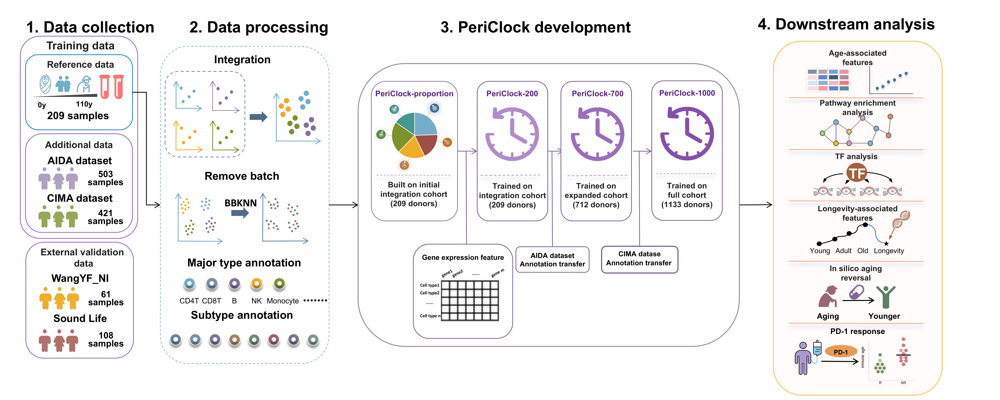

# PeriClock

**A peripheral immune aging clock built from human PBMC single-cell transcriptomes.**

[](https://huggingface.co/LeyiZhang1/PeriClock)
[](https://huggingface.co/datasets/LeyiZhang1/PeriClock-data)

<p align="center">
  
</p>

## Overview

PeriClock is a single-cell transcriptomic aging clock that characterizes human peripheral immune aging by integrating cell-subtype-specific gene expression and cellular composition. Using Elastic Net regression and bootstrap-based stable feature selection, PeriClock was developed through progressive expansion of healthy PBMC cohorts and evaluated in two independent cohorts, Sound Life and WangYF_NI.

Beyond age prediction, PeriClock provides a framework for interpreting stable features of immune aging, exploring cell-type-specific and gene-level expression perturbations, and screening potential regulators through DeSCOPE virtual gene knockout. Its applications to HNSCC and NSCLC further explore associations between pretreatment immune age and immunotherapy response.

This repository provides the PeriClock Python package, usage examples, and research notebooks supporting the accompanying study.

## Available Models

| Model | Inputs / estimator | Training data | Intended use |
| --- | --- | --- | --- |
| **PeriClock** | Subtype expression and proportions / Elastic Net | Integration + AIDA + CIMA; final fit on 1,133 donors | Main donor-level immune-age model |
| **PeriClock-200s** | Subtype expression and proportions / Elastic Net | Integration cohort | Initial-cohort development model |
| **PeriClock-700s** | Subtype expression and proportions / Elastic Net | Integration + AIDA | Expanded-cohort development model |
| **PeriClock-1000s** | Subtype expression and proportions / Elastic Net | Integration + AIDA + CIMA | Full-cohort development model |
| **PeriClock-bulk** | Donor mean expression of 131 PeriClock genes / Elastic Net | Donor-level aggregates from the combined modeling cohort | Expression-only comparison without subtype resolution |
| **PeriClock-proportion** | 48 subtype proportions / Extra Trees | Healthy Integration modeling data | Composition-only comparison |

**Recommended model**. We recommend **PeriClock** as the primary model for peripheral immune age estimation. It is the final model developed using the combined healthy PBMC cohorts (Integration, AIDA and CIMA). The PeriClock-200s, PeriClock-700s and PeriClock-1000s models are provided to illustrate model development across progressively expanded cohorts, while PeriClock-bulk and PeriClock-proportion serve as alternative models for specific analyses and comparisons.

See [model details](docs/models.md) for feature definitions, saved transformations
and prediction outputs.

## Installation

Clone the PeriClock repository and create a Python 3.12 environment:

```bash
git clone https://github.com/LeyiZhang1/PeriClock.git
cd PeriClock

conda create -n periclock python=3.12 -y
conda activate periclock

python -m pip install .
```

For cell annotation using CellTypist, Symphony, or BBKNN, install the optional dependencies:

```bash
python -m pip install ".[annotation]"
```

For Scanpy preprocessing only:

```bash
python -m pip install ".[preprocessing]"

For downloading pretrained models and datasets from Hugging Face, install the optional dependencies:

```bash
python -m pip install ".[hub]"
```

```
See [Installation Guide](docs/installation.md) for additional setup instructions.


## Quick Start

Start with a normalized, subtype-annotated PBMC AnnData. With the Hub extra
installed, download the pretrained model into your chosen external directory.
The repositories are currently private: authorized users must first authenticate
with `hf auth login` or `HF_TOKEN`. Replace paths and observation keys
with those of your data.

```python
from pathlib import Path
import os
import anndata as ad
from huggingface_hub import hf_hub_download
from periclock import load_model, build_model_features, predict_age

adata = ad.read_h5ad("/path/to/prepared_pbmc.h5ad")
model_dir = Path(os.environ.get(
    "PERICLOCK_MODEL_DIR", "~/periclock-resources/models"
)).expanduser()
model_path = hf_hub_download(
    repo_id="LeyiZhang1/PeriClock",
    filename="PeriClock.pkl",
    repo_type="model",
    revision="0e761ebae1010f9c148e0ec7be89063815f21d25",
    local_dir=model_dir,
)
bundle = load_model("PeriClock", model_path=model_path)

features = build_model_features(
    adata,
    model_bundle=bundle,
    individual_key="donor_id",
    celltype_key="cell_subtype_final",
)

predictions = predict_age(
    features,
    model_name=bundle["name"],
    model_bundle=bundle,
)
print(predictions.head())
predictions.to_csv("periclock_predictions.csv")
```

The donor-indexed result contains `Predicted_Age`. An optional donor-indexed
`actual_age` Series or mapping also adds `Actual_Age` and `Age_Diff`
(predicted minus chronological age); chronological age is not a prediction input.

For raw counts, follow [examples/examples.ipynb](examples/examples.ipynb) for
QC metrics, gene-identifier preparation, normalization and CellTypist annotation.
Do not normalize an already normalized matrix again. CellTypist weights and
Symphony/BBKNN references are supplied separately through explicit paths.
See [usage](docs/usage.md) and the [API reference](docs/api_reference.md).

## Input Data

- **Format:** AnnData (`.h5ad`), with unique cell and gene indices.
- **Genes:** compatible, unique gene symbols in `adata.var_names`. Ensembl inputs
  require a reviewed symbol mapping; genes are not automatically remapped.
- **Donors:** a nonmissing donor-identifier column in `adata.obs`.
- **Annotations:** compatible subtype labels for the four subtype-resolved models
  and the proportion model; bulk feature construction does not require them.
- **Expression:** log1p-transformed counts normalized to 10,000 counts per cell
  for expression-based feature construction. Feature construction does not normalize
  or annotate the input automatically.

See [input requirements](docs/input_data.md) and
[preprocessing guidance](docs/preprocessing.md).

## Tutorials

| Notebook | Analysis |
| --- | --- |
| [01 — Proportion clock](tutorials/01_proportion_clock.ipynb) | Composition-based model training, comparison and feature importance |
| [02 — PeriClock development](tutorials/02_periclock_development.ipynb) | Cohort expansion, bootstrap stability and model development |
| [03 — External benchmark](tutorials/03_external_benchmark.ipynb) | Plotting saved external-validation benchmark results |
| [04 — Feature interpretation](tutorials/04_stable_feature_interpretation.ipynb) | Feature composition, expression-age trends and enrichment |
| [05 — Cell-type-specific perturbation](tutorials/05_celltype_specific_perturbation.ipynb) | Constrained perturbation of subtype-specific expression |
| [06 — Gene-level perturbation](tutorials/06_gene_level_perturbation.ipynb) | Coordinated gene perturbations across subtypes |
| [07 — Perturbation stability](tutorials/07_perturbation_stability.ipynb) | Bootstrap stability and functional similarity |
| [08 — DeSCOPE screening](tutorials/08_descope_screening.ipynb) | Downstream statistics from saved virtual-knockout age results |
| [09 — Immunotherapy](tutorials/09_immunotherapy.ipynb) | Pretreatment immune age and immunotherapy response in HNSCC and NSCLC |
| [10 — Bulk clock](tutorials/10_bulk_clock.ipynb) | Bulk-clock training and immunotherapy comparisons |

See the [Tutorials guide](tutorials/README.md) and individual notebooks for required
inputs, environments and execution instructions.

## Models and Data Availability

- **[Hugging Face Models](https://huggingface.co/LeyiZhang1/PeriClock):** all six pretrained models are uploaded.
- **[Hugging Face Datasets](https://huggingface.co/datasets/LeyiZhang1/PeriClock-data):** the repository is created; uploads are in progress. Do not assume every listed file is available yet.

Dataset resources cover:

- `inte_final.h5ad`: the complete healthy/disease PBMC atlas and cell-annotation reference.
- `inte_final_healthy.h5ad`: healthy PBMC modeling data.
- Annotation references, including the 100k subset and prepared Symphony reference.
- The ten-donor example dataset and prepared training feature matrices.
- DeSCOPE knockout-age results for downstream analysis.

Both repositories are currently private and require authorized access. See
[RESOURCE_DOWNLOAD.md](RESOURCE_DOWNLOAD.md) for per-file availability, direct model
links, checksums, pinned revisions and download instructions. External validation
and immunotherapy datasets follow their original access procedures; source
accessions and sample selection are in Supplementary Table 1.

## Citation

If you use PeriClock, please cite the accompanying manuscript:

> Leyi Zhang, Yazi Li, Yanji Qu, Yaojie Zhang, Yuting Wang, Zijia Li,
> Xiantong Jiang, and Chenfei Wang. **Characterizing and perturbing peripheral
> immune aging in humans using PeriClock.** Manuscript.

Publication details and a DOI will be added when confirmed.

## License

Code, pretrained-model and author-generated data licenses await final confirmation.
Third-party datasets and derived resources remain subject to their original terms,
access restrictions and applicable permissions.
